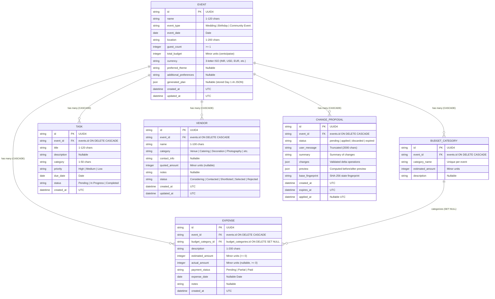

# EventMate AI - GenAI Celebration & Event Planner

EventMate AI is a production-grade, full-stack generative AI celebration and event planning system. Built with React 19, Vite, Tailwind CSS, Lucide icons, Recharts, FastAPI, SQLAlchemy 2.x, Pydantic v2, and the official Google GenAI SDK (`google-genai`).

EventMate AI synthesizes comprehensive execution blueprints (mathematically reconciled budgets, milestone schedules, creative palettes, culinary directives, vendor load-ins, and risk playbooks) and provides persistent event management, expense tracking, milestone workflows, vendor quotation comparisons, and a safe, deterministic AI assistant.

---

## What's New in Day 3: AI Assistant, Safe Plan Changes, Themes, Invitations, Vendors & UI Polish

Day 3 introduces advanced AI assistance with strict deterministic safety guardrails, creative generators, vendor quotation comparisons, and complete UI refinement:

1. **Context-Aware AI Assistant (Ask Mode)**:
   - `POST /api/events/{id}/assistant`: Answers natural-language questions using real-time, server-computed event context (budget allocations, expenses, tasks, vendors, and deadlines).
   - **Strict Read-Only Guardrail**: The assistant cannot modify database state in Ask mode. Database row counts remain guaranteed unchanged.
   - **Demo Mode Honesty**: When `GEMINI_API_KEY` is unset, returns `source: "demo"` with deterministic server-computed analytics and clearly states that no LLM was invoked.

2. **Safe Plan Modification (Propose -> Preview -> Confirm -> Apply)**:
   - **Two-Step Human-in-the-Loop Workflow**: AI only generates a proposed delta; deterministic backend logic validates, previews, and atomically applies it upon explicit user confirmation.
   - **Optimistic Concurrency & Fingerprinting**: State fingerprinting via SHA-256 prevents applying proposals to stale event states.
   - **Time-to-Live (TTL)**: Configurable proposal expiration (`PROPOSAL_TTL_MINUTES=30`, checked lazily on access).
   - **Strict Validation Bounds**:
     - Budget deltas must reconcile exactly to zero (or to a newly specified total budget).
     - Task milestone bounds enforced: `today <= due_date <= event_date`.
     - AI cannot modify existing expenses or mark tasks completed.
     - Atomic database transaction applies category adjustments and inserts tasks cleanly.

3. **Theme & Creative Generator**:
   - `POST /api/themes/recommend`: Produces 3 tailored theme concepts with verified `#RRGGBB` hex color swatches, venue styles, lighting directives, and server-calculated decor budget allocations.
   - One-click "Use this theme" action syncs chosen theme directly to the saved event.

4. **Bilingual Invitation Generator**:
   - `POST /api/invitations/generate`: Generates personalized invitations in English or Hindi (Devanagari script with >= 30% script ratio verification).
   - Pre-computes formal dates and weekdays on the server so the model never guesses calendar arithmetic.
   - Interactive preview card, copy-to-clipboard with fallback and `aria-live` announcement, and regeneration overwrite warning.

5. **Vendor Management & Quotation Comparison**:
   - Full CRUD endpoints (`/api/events/{id}/vendors`, `/api/vendors/{id}`) with categorized tracking (Venue, Catering, Decoration, Photography, etc.).
   - Interactive comparison table highlighting lowest quotes (with visible badges and text), selected vendor differences, and global summary across categories.
   - Quick one-click status change dropdown (Considering, Contacted, Shortlisted, Selected, Rejected).
   - Honest disclaimer: *"Quotes are entered by you. EventMate does not verify vendor quotes, availability, or identities, and does not make bookings."*

6. **8-Tab Accessible UI & Token Polish**:
   - Accessible tabs (`role="tablist"`, `role="tab"`, `aria-selected`, `aria-controls`, and Left/Right keyboard arrow navigation).
   - Tabs: **Overview**, **Budget & Expenses**, **Timeline & Tasks**, **Vendors**, **AI Assistant**, **Themes & Decor**, **Invitations**, **AI Master Plan**.
   - Modular UI primitives (`Button`, `Input`, `Select`, `Textarea`, `Card`, `Badge`, `Alert`).
   - SQLite concurrency safeguard: `PRAGMA busy_timeout=5000` and releasing read connections before async Gemini calls.

---

## Safety Architecture & AI Constraints

```
+-------------------------------------------------------------------------+
|                              USER REQUEST                               |
+-------------------------------------------------------------------------+
                                     |
                                     v
+-------------------------------------------------------------------------+
|                  SERVER-SIDE EVENT CONTEXT BUILDER                      |
|  - Deterministic server-computed numbers (budget summary, task counts)  |
|  - Sanitized untrusted blocks (user messages, notes, history)           |
|  - Redacted secrets and internal vendor contact details                 |
|  - Caps: max 50 tasks, 50 expenses, 30 vendors (300 chars truncated)   |
+-------------------------------------------------------------------------+
                                     |
                                     v
+-------------------------------------------------------------------------+
|                        GEMINI / DEMO MODE INVOCATION                    |
|  - Session released before async call (no SQLite lock contention)       |
|  - Flat, schema-validated Pydantic models (Decimal strings for money)  |
|  - Defensive fence stripping & 1 repair retry on malformed JSON         |
+-------------------------------------------------------------------------+
                                     |
                                     v
+-------------------------------------------------------------------------+
|                  DETERMINISTIC VALIDATOR & PERSISTENCE                  |
|  - Pure validation: category matching, minor integer arithmetic bounds |
|  - Milestone range check: today <= due_date <= event_date               |
|  - State fingerprint validation (SHA-256)                               |
|  - ATOMIC TRANSACTION: DB updated ONLY upon explicit user confirmation  |
+-------------------------------------------------------------------------+
```

---

## Database Architecture (SQLAlchemy 2.x)

### Entity-Relationship Schema



---

## API Endpoints Reference

### AI Assistant & Plan Modifications
- `POST /api/events/{id}/assistant`: Context-aware Q&A in read-only Ask mode.
- `POST /api/events/{id}/assistant/propose-changes`: Generates a structured proposal delta and computed preview.
- `POST /api/events/{id}/assistant/apply-changes`: Confirms and applies a proposal atomically.
- `POST /api/events/{id}/assistant/proposals/{proposal_id}/discard`: Marks a proposal as discarded.

### Creative & Themes
- `POST /api/themes/recommend`: 3 theme concepts with color palettes, decor budgets, and lighting advice.
- `POST /api/invitations/generate`: Bilingual (English/Hindi) formal invitation generator.

### Vendors & Quotation Comparison
- `POST /api/events/{id}/vendors`: Add a vendor with quotation and notes.
- `GET /api/events/{id}/vendors`: List event vendors (supports `category` and `status` query filters).
- `GET /api/events/{id}/vendors/comparison`: Category-by-category quotation comparison, lowest quote indicators, selected vendor differences, and global spend summary.
- `PUT /api/vendors/{vendor_id}`: Update vendor status, quotes, or contact info.
- `DELETE /api/vendors/{vendor_id}`: Delete vendor.

### Events, Expenses & Tasks
- `POST /api/events/generate`: Day 1 AI plan generator with demo mode fallback.
- `POST /api/events`: Create and persist event with optional plan.
- `GET /api/events`: List portfolio events.
- `GET /api/events/{id}`: Detailed event view with summaries and relations.
- `PUT /api/events/{id}`: Update core event parameters.
- `DELETE /api/events/{id}`: Delete event with cascading cleanup.
- `POST /api/events/{id}/expenses`: Add expense.
- `PUT /api/expenses/{id}`: Update expense.
- `DELETE /api/expenses/{id}`: Delete expense.
- `POST /api/events/{id}/tasks`: Add task.
- `PUT /api/tasks/{id}`: Update task.
- `DELETE /api/tasks/{id}`: Delete task.

---

## PowerShell Execution Guide

Run all commands from the workspace root: `d:\Virtual Promptwars\EventMate AI`.

### 1. Run Automated Test Suite (99 pytest tests)
```powershell
.\backend\.venv\Scripts\python -m pytest backend/tests
```

### 2. Run Comprehensive Day 3 End-to-End Verification
```powershell
.\backend\.venv\Scripts\python backend/scripts/verify_e2e_day3.py
```

### 3. Build Production Frontend
```powershell
cd frontend; npm run build; cd ..
```

### 4. Run Backend Server
```powershell
.\backend\.venv\Scripts\python -m uvicorn app.main:app --app-dir backend --host 127.0.0.1 --port 8000 --reload
```

### 5. Run Frontend Development Server
```powershell
cd frontend; npm run dev
```

---

## Deadline Status

- **Status as of 30 Oct 2026**: Fully green and passing.
- **Official Deadline**: 1 Nov 2026.
- **Test Results**: 99 of 99 pytest tests pass in ~3.6s. End-to-end user verification passes with 100% clean teardown. Frontend Vite production build completes in ~570ms with zero errors.
