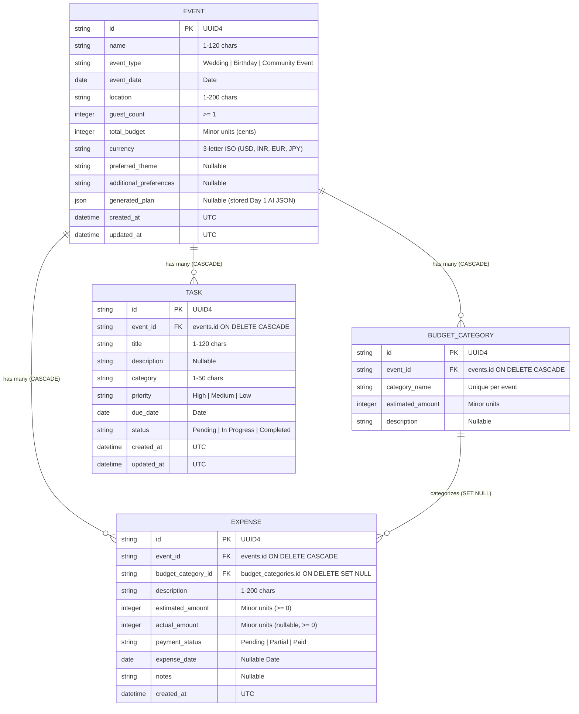

# EventMate AI - GenAI Celebration & Event Planner

EventMate AI is a production-grade, full-stack generative AI celebration and event planning system. Built with React 19, Vite, Tailwind CSS, Lucide icons, Recharts, FastAPI, SQLAlchemy 2.x, Pydantic v2, and the official Google GenAI SDK (`google-genai`).

EventMate AI synthesizes comprehensive execution blueprints (mathematically reconciled budgets, milestone schedules, creative palettes, culinary directives, vendor load-ins, and risk playbooks) and provides persistent event management, expense tracking, and deadline workflows.

---

## What's New in Day 2: Persistent Event Management, Budget & Timeline

Day 2 transforms the ephemeral AI event planner into a persistent event manager:
1. **Persistent SQLite Engine (SQLAlchemy 2.x)**:
   - Robust relational storage in `backend/eventmate.db` with absolute-path resolution.
   - Enforced foreign key integrity via engine connection listener (`PRAGMA foreign_keys=ON`).
   - Declarative models (`Mapped`, `mapped_column`, `select()`, `selectinload`) with UUID4 primary keys and UTC timestamps.
   - Cascading deletions (`cascade="all, delete-orphan", passive_deletes=True`): deleting an event cleanly purges all its budget categories, expenses, and tasks.
   - Non-destructive, idempotent table initialization on startup (`Base.metadata.create_all`).
2. **Exact Minor-Unit Currency System**:
   - Zero-floating-point financial calculations using Python `Decimal` and integer minor units (cents, paise, yen).
   - Currency exponent table (`JPY=0`, `USD/EUR/GBP/INR=2`).
   - Strict input validation rejecting negative values, excessive decimal places, and out-of-range figures with HTTP 422.
3. **Deterministic Summaries Module (`summary.py`)**:
   - Single source of truth for budget and task analytics.
   - Budget analytics: total budget, estimated total, actual spend, remaining funds, utilization percentage, over-budget detection, unallocated buffer, category breakdown (with an uncategorized bucket), and pending payments tracker.
   - Task analytics: total, pending, in-progress, completed, overdue, upcoming (within 7 days), and progress percentage.
   - Timezone-safe and test-injectable `get_today()` helper.
4. **Comprehensive REST API**:
   - Full CRUD for Events, Budget Categories, Expenses, and Tasks.
   - Atomic plan-saving endpoint (`POST /api/events`) executing event creation, category mapping with Hare-Niemeyer reconciliation, and timeline task conversion in a single database transaction.
   - CORS middleware updated to explicitly support `GET`, `POST`, `PUT`, `DELETE`, and `OPTIONS`.
5. **Modern React SPA with `react-router-dom`**:
   - `/`: Dashboard showing saved events, KPI overview, search/filter, budget utilization bars, task progress bars, and next deadline indicators.
   - `/events/new`: Event creation blueprint form, AI generation, and double-click protected "Save Event to Database" action.
   - `/events/:id`: Multi-tab event manager (Overview with inline editing, Budget & Expenses with Recharts breakdown and modal CRUD, Timeline & Tasks with status filtering and quick completion toggle, AI Master Plan).
   - Accessible `ConfirmDialog` modal (`role="alertdialog"`, Escape key dismissal, focus management) for all destructive actions.
   - `vercel.json` SPA rewrite configuration for seamless client-side routing.

---

## Database Architecture (SQLAlchemy 2.x)

### Database Location & Connection
- **Default Database File**: `backend/eventmate.db` (auto-created on startup with tables if not present).
- **Environment Variable**: `DATABASE_URL` in `backend/.env` (defaults to `sqlite:///<absolute_path_to_backend>/eventmate.db`).
- **Resetting the Database**: Simply stop the backend and delete `backend/eventmate.db` (and any `*.db-journal`, `*.db-wal`, `*.db-shm` files). Restarting the backend automatically reinitializes a clean database.
- **Schema Migration Notice**: Tables are initialized using `Base.metadata.create_all(bind=engine)`, which is idempotent and non-destructive. If you introduce future schema alterations (such as altering column types or constraints), use a manual SQLite migration script or integrate Alembic.

### Entity Relational Schema



---

## API Reference

### 1. Health & AI Blueprint Generation (Day 1)
| Method | Endpoint | Status | Description |
| :--- | :--- | :--- | :--- |
| `GET` | `/health` | `200` | Service health status, environment mode, and database connection. |
| `POST` | `/api/events/generate` | `200` | Synthesize reconciled budget, timeline milestones, and creative directives via Gemini or Demo Engine. |

### 2. Events API (Day 2)
| Method | Endpoint | Status | Description |
| :--- | :--- | :--- | :--- |
| `POST` | `/api/events` | `201` | Create and save an event. If `generated_plan` is supplied, atomically creates budget categories (reconciled) and tasks. |
| `GET` | `/api/events` | `200` | List summary of all saved events (newest first) with budget utilization %, task progress %, and next deadline. |
| `GET` | `/api/events/{id}` | `200` | Get full event details including categories, expenses, tasks, `generated_plan`, `budget_summary`, and `task_summary`. |
| `PUT` | `/api/events/{id}` | `200` | Update editable event fields (`name`, `event_date`, `guest_count`, `total_budget`, etc.). Rejects currency changes if expenses exist. |
| `DELETE`| `/api/events/{id}` | `204` | Delete event and cascade delete all related categories, expenses, and tasks. |

### 3. Expenses API (Day 2)
| Method | Endpoint | Status | Description |
| :--- | :--- | :--- | :--- |
| `POST` | `/api/events/{id}/expenses` | `201` | Log a new expense for an event. Verifies `budget_category_id` belongs to the same event. |
| `GET` | `/api/events/{id}/expenses` | `200` | List all expenses for an event. |
| `PUT` | `/api/expenses/{id}` | `200` | Update an existing expense. Category must match the same event; `event_id` is immutable. |
| `DELETE`| `/api/expenses/{id}` | `204` | Delete an expense. |

### 4. Tasks API (Day 2)
| Method | Endpoint | Status | Description |
| :--- | :--- | :--- | :--- |
| `POST` | `/api/events/{id}/tasks` | `201` | Create a new task for an event. Flagged with `is_overdue`, `is_upcoming`, and `after_event_date`. |
| `GET` | `/api/events/{id}/tasks` | `200` | List tasks for an event. Optional `?status=` filter (`Pending`, `In Progress`, `Completed`). |
| `PUT` | `/api/tasks/{id}` | `200` | Update task title, status, priority, due date, or description. |
| `DELETE`| `/api/tasks/{id}` | `204` | Delete a task. |

---

## Money & Financial Number Rules

- **Minor Units Internally**: All monetary values are converted to and stored as integer minor units (e.g. `$1,250.00` = `125000` cents, `¥5,000` = `5000` yen).
- **Decimal Representation**: The API accepts numbers or decimal strings (`"1250.00"`) and returns strings with exact decimal formatting.
- **Validation**:
  - Values with more decimal places than the currency exponent allows are rejected with `HTTP 422`.
  - Negative values are rejected with `HTTP 422`.
  - Values exceeding $100 Billion ($10^{11}$) are rejected with `HTTP 422`.

---

## Exact Windows PowerShell Setup & Run Commands

All commands below are compatible with Windows PowerShell.

### 1. Backend Setup & Run

Open a PowerShell terminal in the repository root (`EventMate AI`):

```powershell
# Navigate to backend directory
cd backend

# If script execution is restricted on your machine:
Set-ExecutionPolicy -Scope Process -ExecutionPolicy Bypass

# Create virtual environment (if not already created)
python -m venv .venv

# Activate virtual environment
.\.venv\Scripts\Activate.ps1

# Install requirements (FastAPI, SQLAlchemy, google-genai, etc.)
pip install -r requirements.txt

# Run FastAPI backend server (database auto-initializes)
python -m uvicorn app.main:app --reload --host 127.0.0.1 --port 8000
```
Backend is available at: **`http://127.0.0.1:8000`** (Swagger docs at `/docs`, health check at `/health`).

---

### 2. Frontend Setup & Run

Open a separate PowerShell terminal in the repository root (`EventMate AI`):

```powershell
# Navigate to frontend directory
cd frontend

# Install dependencies (React 19, react-router-dom, Vite, Lucide, Recharts)
npm.cmd install

# Start Vite development server
npm.cmd run dev
```
Frontend is available at: **`http://localhost:5173`**.

---

### 3. Automated Tests & Verification

From the repository root (`EventMate AI`):

```powershell
# Run the complete Pytest suite (55 tests: Day 1 AI/budget + Day 2 persistence/math/CORS)
.\backend\.venv\Scripts\pytest -v backend\tests

# Run the 14-step End-to-End API lifecycle verification script
powershell -NoProfile -ExecutionPolicy Bypass -File backend\verify_e2e.ps1

# Run the database persistence verification script (verifies data survives server restart)
powershell -NoProfile -ExecutionPolicy Bypass -File backend\verify_persistence.ps1

# Run frontend production build
cd frontend
npm.cmd run build

# Run frontend linter
npm.cmd run lint
```
