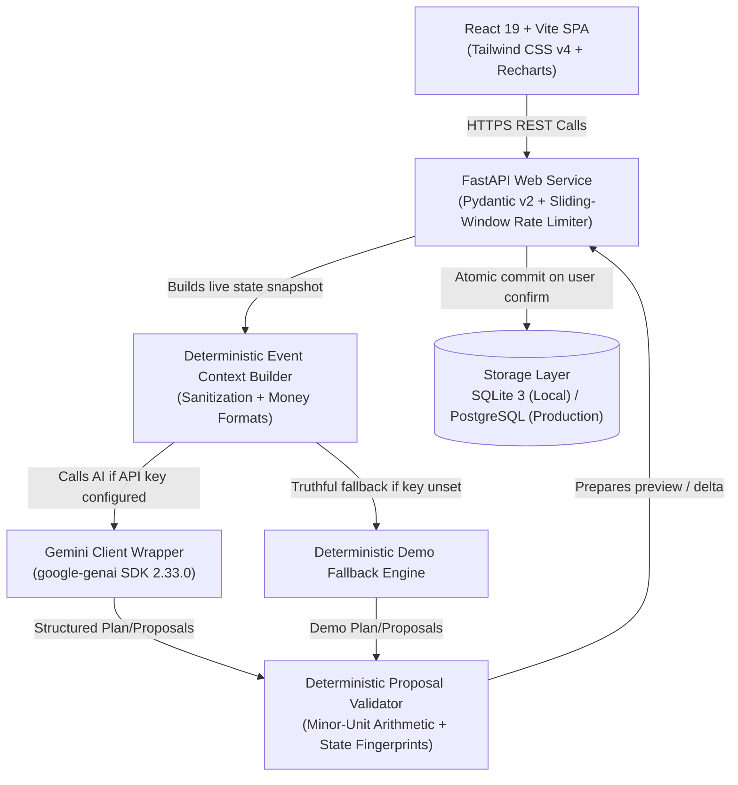

# EventMate AI - GenAI Celebration & Event Planner

EventMate AI is a production-grade, full-stack generative AI celebration and event planning system built for **Challenge 5 (GenAI Celebration & Event Planner)**. Built with React 19, Vite, Tailwind CSS v4, Lucide icons, Recharts, FastAPI, SQLAlchemy 2.x, Pydantic v2, and the official Google GenAI SDK (`google-genai`).

EventMate AI synthesizes comprehensive execution blueprints (mathematically reconciled budgets, milestone schedules, creative palettes, culinary directives, vendor load-ins, and risk playbooks) and provides persistent event management, expense tracking, milestone workflows, vendor quotation comparisons, and a deterministic, safe AI assistant.

---

## Architecture Diagram



---

## Tech Stack & Versions

- **Frontend**:
  - React 19.x & React DOM 19.x
  - Vite 8.x (with route-level code splitting via `React.lazy` and `Suspense`)
  - Tailwind CSS v4.x
  - Lucide React (feathered icons)
  - Recharts (budget distribution & expense metrics)
  - React Router DOM v7.x
- **Backend**:
  - FastAPI 0.115+
  - Pydantic v2.10+ (strict validation and schema typing)
  - SQLAlchemy 2.0+ (with SQLite dialect pragmas and PostgreSQL `BigInteger` portability)
  - Uvicorn 0.34+ (ASGI production server)
  - `google-genai` 2.33.0 (Official Google Gemini SDK)
  - SQLite 3 (local) / PostgreSQL (production-ready)

---

## Feature Progression (Day 1 to Day 4)

- **Day 1: AI Plan Generation & Deterministic Validation**:
  - AI generation for Weddings, Birthdays, and Community Events.
  - Strict mathematical reconciliation guarantees category budgets sum to 100% of total budget.
  - Milestone timeline bounds: `today <= due_date <= event_date`.
  - Truthful Demo Mode when `GEMINI_API_KEY` is not configured.
- **Day 2: Persistence & Event Operations**:
  - SQLite database persistence with relational models (Events, Budget Categories, Expenses, Tasks).
  - Cascade deletion on parent event removal.
  - Full CRUD operations with minor-unit integer arithmetic avoiding IEEE 754 floating point drift.
  - Multi-tab event workspace with confirm dialogs and financial summaries.
- **Day 3: AI Assistant, Safe Plan Changes, Themes, Invitations & Vendors**:
  - **Context-Aware Assistant**: Read-only Ask mode answering questions using server-computed analytics. Row counts guaranteed unchanged.
  - **Safe Plan Modification**: Propose &rarr; Preview &rarr; Confirm &rarr; Apply workflow with optimistic concurrency fingerprints (SHA-256) and TTL expiration.
  - **Theme & Creative Generator**: Curated theme palettes with verified `#RRGGBB` hex color swatches and estimated decor budgets.
  - **Bilingual Invitations**: English and authentic Hindi (Devanagari script with $\ge 30\%$ script ratio verification).
  - **Vendor Management**: Quotation comparisons highlighting lowest quotes and selected vendor differences.
  - **Accessible UI**: ARIA tab navigation (`role="tablist"` / `role="tab"`), keyboard arrow navigation, and custom UI components.
- **Day 4: Release Hardening, Testing & Deployment Readiness**:
  - In-memory sliding-window rate limiting on all AI endpoints (429 with `Retry-After`).
  - Route-level code splitting keeping all JS chunks under 500 kB.
  - Zero-dependency CLI live smoke testing script (`backend/scripts/smoke_test.py`).
  - End-to-end automated journey test (`test_e2e_workflow.py`).
  - Production readiness on Render (backend) and Vercel (frontend) documented in [`docs/DEPLOYMENT.md`](file:///d:/Virtual%20Promptwars/EventMate%20AI/docs/DEPLOYMENT.md).

---

## Safe Plan Modification Architecture

EventMate AI follows a strict **Human-in-the-Loop** model. The AI may **only propose**; deterministic backend code validates and applies:

1. **User Request**: The user asks to adjust budget or add tasks (e.g., *"Move 20,000 from Venue to Decoration"*).
2. **AI Proposal**: Gemini generates a structured delta containing proposed category adjustments and task additions.
3. **Deterministic Validation**:
   - Arithmetic is computed in minor integer units (paise/cents).
   - Category budget adjustments must sum to zero (or match a newly approved total budget).
   - Milestone dates must obey `today <= due_date <= event_date`.
   - Invariant tables (Expenses, Vendors, Original Plan) are strictly locked and cannot be touched by the AI.
4. **State Fingerprinting**: A SHA-256 hash of the event's current state is recorded in a temporary `ChangeProposal` record with a 15-minute TTL.
5. **Preview & Confirm**: The frontend displays a side-by-side diff preview. The proposal is only committed when the user clicks **Confirm & Apply**.
6. **Atomic Transaction**: If the event has been modified concurrently, fingerprint validation rejects the apply with HTTP 409 Conflict. If unchanged, changes are committed in a single database transaction.

---

## API Endpoints Directory

All endpoints are unauthenticated (auth is intentionally out of scope for Challenge 5):

| Method | Endpoint Path | Description |
| :--- | :--- | :--- |
| `GET` | `/api/health` | System health and AI configuration status |
| `GET` | `/api/health/ready` | Database readiness check |
| `POST` | `/api/events/generate` | Generate initial comprehensive event plan |
| `GET` | `/api/events` | List all saved events with summaries |
| `POST` | `/api/events` | Create new event from plan or parameters |
| `GET` | `/api/events/{id}` | Get full event details, budget summary, and task summary |
| `PUT` | `/api/events/{id}` | Update event parameters (name, date, guests, location) |
| `DELETE`| `/api/events/{id}` | Delete event and cascade delete all child records |
| `POST` | `/api/events/{id}/expenses` | Record a new expense |
| `PUT` | `/api/expenses/{id}` | Update expense details or actual amount |
| `DELETE`| `/api/expenses/{id}` | Delete an expense |
| `POST` | `/api/events/{id}/tasks` | Create a new milestone task |
| `GET` | `/api/events/{id}/tasks` | List tasks with optional status filter |
| `PUT` | `/api/tasks/{id}` | Update task status or due date |
| `DELETE`| `/api/tasks/{id}` | Delete a task |
| `POST` | `/api/events/{id}/vendors` | Add a vendor |
| `GET` | `/api/events/{id}/vendors` | List vendors with optional filters |
| `GET` | `/api/events/{id}/vendors/comparison`| Compare vendor quotes grouped by category |
| `PUT` | `/api/vendors/{id}` | Update vendor quote or status |
| `DELETE`| `/api/vendors/{id}` | Delete a vendor |
| `POST` | `/api/events/{id}/assistant` | Ask mode: Ask questions about current event (Read-only) |
| `POST` | `/api/events/{id}/assistant/propose-changes`| Modify mode: Propose safe plan changes |
| `POST` | `/api/events/{id}/assistant/apply-changes` | Confirm and atomically apply a proposal |
| `POST` | `/api/events/{id}/assistant/discard-proposal`| Discard a proposed plan change |
| `POST` | `/api/themes/recommend` | Stateless theme and decoration generator |
| `POST` | `/api/invitations/generate` | Bilingual invitation generator (English & Hindi) |

---

## Local Setup & Quickstart

### Prerequisites
- Python 3.11+
- Node.js 18+ & npm 9+
- Git

### 1. Backend Setup (PowerShell / Windows)
```powershell
cd backend
python -m venv .venv
.\.venv\Scripts\Activate.ps1
pip install -r requirements.txt
Copy-Item .env.example .env
# Edit .env to add your GEMINI_API_KEY (or leave blank for Demo Mode)
python -m uvicorn app.main:app --reload --port 8000
```

### 1. Backend Setup (macOS / Linux)
```bash
cd backend
python3 -m venv .venv
source .venv/bin/activate
pip install -r requirements.txt
cp .env.example .env
# Edit .env to add your GEMINI_API_KEY (or leave blank for Demo Mode)
uvicorn app.main:app --reload --port 8000
```

### 2. Frontend Setup
```bash
cd frontend
npm install
npm run dev
# Open http://localhost:5173 in your browser
```

---

## Testing & Verification

### Running Automated Pytest Suite
```bash
# From workspace root
.\backend\.venv\Scripts\python -m pytest backend/tests -v
```
All **107 unit, integration, rate-limiter, and end-to-end workflow tests** execute in under 6 seconds against isolated temporary SQLite databases.

### Running Live Smoke Test Script
The zero-dependency CLI smoke test runs against any live backend URL:
```bash
# Against local server
.\backend\.venv\Scripts\python backend/scripts/smoke_test.py --base-url http://127.0.0.1:8000 --with-ai

# Against remote production deployment
python backend/scripts/smoke_test.py --base-url https://eventmate-api.onrender.com --with-ai
```

---

## Production Deployment

EventMate AI is configured for zero-downtime deployment:
- **Backend on Render**: Uses [`render.yaml`](file:///d:/Virtual%20Promptwars/EventMate%20AI/render.yaml) for automated Blueprint deployment.
- **Frontend on Vercel**: Uses [`frontend/vercel.json`](file:///d:/Virtual%20Promptwars/EventMate%20AI/frontend/vercel.json) with SPA rewrites and HTTP security headers (`nosniff`, `strict-origin-when-cross-origin`).

For full deployment instructions, environment variables, and troubleshooting, read the **[Deployment Runbook (`docs/DEPLOYMENT.md`)](file:///d:/Virtual%20Promptwars/EventMate%20AI/docs/DEPLOYMENT.md)**.

---

## Known Limitations & Future Work

- **Authentication & Multi-Tenancy**: Out of scope for Challenge 5; all data in the local SQLite instance is shared. Future work will introduce JWT OAuth2 authentication.
- **Online Payments**: Vendor bookings and quote acceptance are advisory only; no actual payment gateway is integrated.
- **Image Generation**: Creative themes provide structured hex color palettes, lighting styles, and decor ideas; diffusion image generation was excluded to preserve strict latency bounds.
- **Free-Tier Cold Starts**: On free Render instances, initial requests after inactivity may take 30-45 seconds. The frontend includes automatic slow-start detection banners and GET retries.
