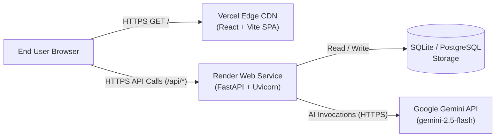

# EventMate AI: Production Deployment Runbook

This guide details the step-by-step procedure for deploying **EventMate AI** across a decoupled, production-grade cloud architecture:
- **Backend**: FastAPI web service hosted on [Render](https://render.com) (with optional PostgreSQL or persistent disk).
- **Frontend**: React + Vite SPA hosted on [Vercel](https://vercel.com) (with global CDN edge caching).

Deployment Status: **Prepared, Not Deployed** (Autonomous audit complete; ready for manual zero-downtime execution).

---

## Architecture & Data Flow



---

## 1. Prerequisites

Before starting deployment, ensure you have:
1. **GitHub / GitLab Repository**: Pushed copy of the workspace containing the root `render.yaml` and `frontend/vercel.json`.
2. **Google Gemini API Key**: Acquired from [Google AI Studio](https://aistudio.google.com/). *(Optional: without a key, the backend automatically operates in truthful Demo Mode)*.
3. **Render Account**: Signed up at [render.com](https://render.com).
4. **Vercel Account**: Signed up at [vercel.com](https://vercel.com).
5. **Python 3.11+ & Node 18+**: For running local smoke validation scripts.

---

## 2. Step 1: Deploy Backend to Render

### Option A: Via Render Blueprint (Recommended)
1. Log in to the [Render Dashboard](https://dashboard.render.com).
2. Click **New +** &rarr; **Blueprint**.
3. Connect your repository.
4. Render will automatically detect and parse [`render.yaml`](file:///d:/Virtual%20Promptwars/EventMate%20AI/render.yaml).
5. Enter the values for required environment variables:
   - `GEMINI_API_KEY`: Paste your Gemini API key (kept encrypted, never logged).
   - `CORS_ORIGINS`: Set initially to `http://localhost:5173,http://localhost:4173`.
6. Click **Apply**.

### Option B: Manual Web Service Setup
If not using Blueprints:
1. Click **New +** &rarr; **Web Service**.
2. Connect your repository and select **Python 3** environment.
3. Configure the service settings:
   - **Name**: `eventmate-api`
   - **Region**: `Oregon (US West)` or nearest to target users
   - **Branch**: `main`
   - **Root Directory**: Leave blank (uses repo root)
   - **Build Command**: `pip install -r backend/requirements.txt`
   - **Start Command**: `uvicorn app.main:app --app-dir backend --host 0.0.0.0 --port $PORT`
   - **Health Check Path**: `/api/health`
4. Add the following **Environment Variables**:
   | Variable | Value | Description |
   | :--- | :--- | :--- |
   | `GEMINI_API_KEY` | `AIza...` | Secret Google Gemini API Key |
   | `GEMINI_MODEL` | `gemini-2.5-flash` | Gemini model name |
   | `CORS_ORIGINS` | `http://localhost:5173,http://localhost:4173` | Allowed origin domains (comma-separated) |
   | `CORS_ORIGIN_REGEX` | `^https://.*\.vercel\.app$` | Matches all Vercel production and preview subdomains |
   | `PROPOSAL_TTL_MINUTES` | `15` | Minutes before an unapplied AI proposal expires |
   | `AI_RATE_LIMIT_PER_MINUTE` | `10` | Max AI generation requests per minute per client IP |
   | `TRUST_PROXY_HEADERS` | `true` | Enables reading client IPs from `X-Forwarded-For` on Render |
   | `LOG_LEVEL` | `INFO` | Application log verbosity |

### Backend Verification
Once Render finishes building and starts the container, note your public URL (e.g., `https://eventmate-api.onrender.com`). Verify it in your terminal:
```bash
curl -s https://eventmate-api.onrender.com/api/health
# Expected Output: {"status":"ok","ai_configured":true,"model":"gemini-2.5-flash"}

curl -s https://eventmate-api.onrender.com/api/health/ready
# Expected Output: {"status":"ok","database":"ok"}
```

---

## 3. Step 2: Deploy Frontend to Vercel

1. Log in to the [Vercel Dashboard](https://vercel.com/dashboard).
2. Click **Add New...** &rarr; **Project**.
3. Import your Git repository.
4. Configure Project Settings:
   - **Framework Preset**: `Vite`
   - **Root Directory**: Click *Edit* and select `frontend` (or leave root if running from `frontend`).
   - **Build Command**: `npm run build`
   - **Output Directory**: `dist`
5. Expand **Environment Variables** and add:
   - **Name**: `VITE_API_BASE_URL`
   - **Value**: `https://eventmate-api.onrender.com` *(your actual Render backend URL without trailing slash)*
6. Click **Deploy**.

### Frontend Verification
Once Vercel deployment completes, open your assigned URL (e.g., `https://eventmate-ai.vercel.app`).
1. Check that the Dashboard loads smoothly without configuration error banners.
2. In browser DevTools &rarr; Network, confirm that requests to `/api/events` and `/api/health` return HTTP 200.

---

## 4. Step 3: Finalize CORS on Render

Now that your live Vercel domain is known:
1. Open Render Dashboard &rarr; `eventmate-api` &rarr; **Environment**.
2. Update `CORS_ORIGINS` to include your exact Vercel production domain:
   ```env
   CORS_ORIGINS=https://eventmate-ai.vercel.app,http://localhost:5173,http://localhost:4173
   ```
   *(Note: The pre-configured `CORS_ORIGIN_REGEX=^https://.*\.vercel\.app$` automatically protects all Vercel preview branch deployments).*
3. Save changes. Render will automatically redeploy the backend in seconds.

---

## 5. Step 4: Run Live Smoke Verification

Validate the entire end-to-end cloud pipeline using the zero-dependency CLI smoke test script:

```bash
# Run against the live production backend
python backend/scripts/smoke_test.py --base-url https://eventmate-api.onrender.com --with-ai
```

### Expected Output
```text
============================================================
Starting EventMate AI Smoke Test -> Base URL: https://eventmate-api.onrender.com
============================================================

[1/3] Testing Health & Readiness endpoints...
  [OK] GET /api/health -> status=ok ai_configured=True model=gemini-2.5-flash
  [OK] GET /api/health/ready -> status=ok database=ok

[2/3] Testing Core Event, Expense, Task & Vendor Lifecycle...
  [OK] POST /api/events -> created event id=...
  [OK] POST /api/events/.../expenses -> created expense id=...
  [OK] POST /api/events/.../tasks -> created task id=...
  [OK] POST /api/events/.../vendors -> created vendor id=...
  [OK] GET /api/events/... -> verified budget_summary and task_summary
  [OK] GET /api/events/.../vendors/comparison -> verified selected_total='4800.00'

[3/3] Testing AI / Demo Generation Endpoints (--with-ai enabled)...
  [OK] POST /api/events/generate -> source=gemini overview='A meticulously organized plan...'
  [OK] POST /api/themes/recommend -> source=gemini themes=[...]
  [OK] POST /api/invitations/generate -> source=gemini text='You are cordially invited...'

============================================================
ALL SMOKE TESTS COMPLETED SUCCESSFULLY! (Exit Code 0)
============================================================

[CLEANUP] Deleting temporary smoke test event id=...
  [OK] Cleanup complete. Temporary event deleted.
```

---

## 6. Production Troubleshooting Guide

### Cold Start Lag (Render Free Tier)
- **Symptom**: First request after 15 minutes of inactivity takes 35-50 seconds.
- **Remedy**: The frontend automatically displays a friendly amber banner (`"Backend is waking up, thanks for your patience..."`) after 5 seconds of waiting, and auto-retries failed GET requests once after a 3-second delay. For persistent active servers, upgrade Render to the Starter tier ($7/mo).

### CORS Preflight Failures (`403 Forbidden` / `CORS Error`)
- **Symptom**: Browser console warns `Access to fetch at ... from origin ... has been blocked by CORS policy`.
- **Remedy**: Ensure the Vercel domain matches `CORS_ORIGIN_REGEX` or is explicitly added to `CORS_ORIGINS` on Render. Check that there are no trailing slashes on origin URLs.

### 429 Rate Limit Response (`Retry-After`)
- **Symptom**: AI generation or assistant calls return 429.
- **Remedy**: EventMate AI enforces an in-memory sliding window rate limiter (default: 10 requests/minute per client IP). The frontend captures the `Retry-After` header and clearly advises the user when to retry.

### Missing `VITE_API_BASE_URL` Error Screen
- **Symptom**: The browser displays a full-page amber error: *"Missing Production API Configuration"*.
- **Remedy**: `VITE_` variables are baked into Vite code at build time. Go to Vercel Project Settings &rarr; Environment Variables, add `VITE_API_BASE_URL`, and trigger a new deployment.

